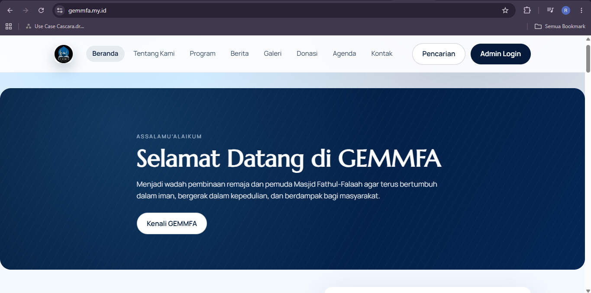

# Gemmfa Website

Website organisasi Gemmfa yang dikembangkan menggunakan Laravel sebagai bagian dari proyek pengembangan web.

## Tentang Proyek

Gemmfa Website merupakan aplikasi web untuk mendukung penyampaian informasi dan pengelolaan konten organisasi melalui satu platform.

Proyek ini dikembangkan untuk menerapkan keterampilan web development, khususnya dalam membangun aplikasi menggunakan PHP dan Laravel.

## Tampilan Website

Website GEMMFA telah memiliki halaman utama dengan navigasi informasi organisasi, program, berita, galeri, donasi, dan kontak.



## Fitur

Berdasarkan struktur kode proyek, fitur yang dikembangkan mencakup:

- **Program:** halaman informasi program organisasi.
- **Agenda:** pengelolaan dan penyajian informasi agenda kegiatan.
- **Donasi:** fitur terkait informasi atau pengelolaan donasi.
- **Galeri:** pengelolaan konten galeri.
- **Kontak:** fitur untuk informasi dan komunikasi dengan organisasi.

*Catatan: Sesuaikan daftar fitur ini dengan fitur yang benar-benar sudah berfungsi di aplikasi.*

## Teknologi

- PHP
- Laravel
- Blade Template Engine
- HTML dan CSS
- JavaScript
- Composer
- NPM

## Instalasi dan Menjalankan Proyek

### Prasyarat

Pastikan perangkat sudah memiliki:

- PHP dengan ekstensi yang dibutuhkan Laravel
- Composer
- Node.js dan NPM
- Database yang sesuai dengan konfigurasi aplikasi

### 1. Clone repository

```bash
git clone https://github.com/RifqiAiniWahdaniyatillahi/gemmfa-website.git
cd gemmfa-website
```

### 2. Instal dependensi PHP

```bash
composer install
```

### 3. Siapkan file environment

```bash
cp .env.example .env
```

Pada Windows, file `.env.example` juga dapat disalin secara manual menjadi `.env`.

### 4. Buat application key

```bash
php artisan key:generate
```

### 5. Konfigurasikan database

Sesuaikan pengaturan database di file `.env` dengan lingkungan lokal.

Jika aplikasi menggunakan migrasi database dan database sudah dikonfigurasi dengan benar, jalankan:

```bash
php artisan migrate
```

### 6. Instal dependensi frontend

```bash
npm install
```

### 7. Jalankan aplikasi

Buka terminal pertama:

```bash
php artisan serve
```

Buka terminal kedua:

```bash
npm run dev
```

Kemudian akses alamat lokal yang ditampilkan oleh Laravel di browser.

## Tujuan Pengembangan

Proyek ini menjadi bagian dari portofolio pengembangan web untuk menunjukkan penerapan PHP, Laravel, pengelolaan database, dan pengembangan fitur aplikasi web.

## Pengembang

**Rifqi Aini Wahdaniyatillahi**

GitHub: [RifqiAiniWahdaniyatillahi](https://github.com/RifqiAiniWahdaniyatillahi)

## Status Proyek

Pengembangan dan penyempurnaan fitur dilakukan secara bertahap.
